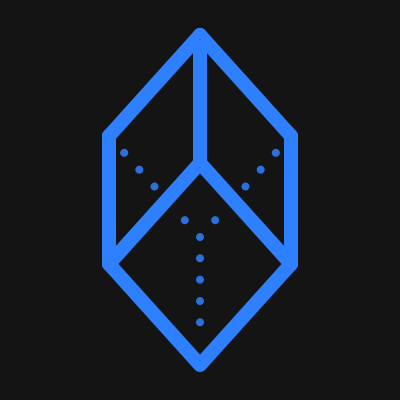

# r1-mod



A client mod and launcher for the Call of Duty Online **3.3.3.3 QA build** (2015-06-15), for playing on private and
LAN servers without Tencent's services.

> [!IMPORTANT]
> r1-mod works **only** with the Call of Duty Online **3.3.3.3 QA build**. No other build, retail or test, is
> supported. You need your own copy: the build is not distributed here, and this guide does not cover where to get
> it.
>
> The build's game files must be **unpacked** before r1-mod can use them. The client has to read loose files
> (models, images and sounds in `main\`, zones in `client_shipRetail\chinese\`) rather than Tencent's packed
> archives, and it is started as a loose-file client exe (`game_exe` in `r1-mod.ini`, default
> `codoMP_client_shipRetail_loosefs_v2.exe`). Unpacking is not covered here.

The QA build is the base because, once unpacked, its models and images are loose files. Later retail builds such as
3.19 pack everything into Tencent IIPS archives, so a mod that adds assets would have to re-pack them.

**Status: work in progress, release 2026.11.11.3** (versions are release dates, see `CHANGELOG.md`). It reaches the
lobby, joins a local server through the lobby's own path, keeps loadouts, operators and stats offline, loads GSC
mods on the local server (`cx_mod`) and has iw4x's movement dvars. Checking finer gameplay and UI details against the
live game (veteran players, videos, screenshots) is ongoing.

## Features

- **Launcher** (`r1-mod.exe`): points the game at the local Demonware backend, starts the backend and the client,
  and injects `r1-mod.dll` before the game's own code runs.
- **Offline profile**: skips the first-run operator screen, keeps playerdata (classes, operators, tutorial flags)
  in `r1-mod_playerdata.bin` with automatic backups, every item unlocked, and level, prestige and weapon levels raised.
- **In-game console** (`` ` ``) with completion and history, and a **server browser** (F6), drawn with Dear ImGui.
- **Joining servers**: `cx_match <ip> [port] [password]` joins any r1-server, on this PC or another, through the
  lobby's own StartGame path; the server browser (F6) lists servers from a master. Plus `cx_rcon`.
- **Server text**: the server's message of the day on the loading screen, and IW4x-style colours (`^:` rainbow,
  `^;` the server's colour) in names, chat and messages.
- **Settings the QA build lacks**: frame rate cap up to 1000 (`cx_fps`), turn speed (`cx_yawspeed`,
  `cx_pitchspeed`), player name (`cx_name`), operator swap (`cx_operator`).

All commands, settings and engine hooks are described in [docs/CLIENT.md](docs/CLIENT.md).

## Requirements

- Your own copy of the CoD Online 3.3.3.3 QA build, unpacked (see [Prepare the game](#prepare-the-game)).
- For the server: your own CoD Online 1.1.1.13 install and [r1-server](#related-repository).
- Visual Studio 2022 or its Build Tools with the C++ x86 tools, to build.
- Python 3 with [uv](https://github.com/astral-sh/uv), for the backend and the tools.

## Prepare the game

r1-mod runs against an **unpacked** QA 3.3.3.3 build (see the note above), started through a loose-file-capable
client exe (`game_exe` in `r1-mod.ini`). Unpacking the build and producing that exe are not covered here.

Then set up the local Demonware backend once (`backend\README.md`): its certificate, which the game must trust,
and its publisher files.

## Related repository

**r1-server** is the native dedicated server these clients play on: the sh1x / CoD4x fork that runs CoD
Online 1.1.1.13 game logic and speaks the QA 3.3.3.3 wire format. It is developed and released separately
(AGPL-3.0) and is not public yet. What r1-mod expects from a server, and the compatibility number both sides
declare, is in [docs/COMPATIBILITY.md](docs/COMPATIBILITY.md).

### Join a server

In the r1-mod console: `cx_match <ip> [port] [password]` (port 28960 by default; `ip:port` works too). The password
is the server's join password, if it has one; `join_password` in `r1-mod.ini` is used when you give none, and for
servers joined from the browser. Before the join, your backend asks the server for its match key, so nothing else
has to be set up. To see servers in the browser (F6), set `master=<host>:<port>` in `r1-mod.ini` to a master the
servers heartbeat to.

### Host a server

Follow r1-server's README ("Host a server"): it needs your unpacked game files, base GSC scripts, and this
repository's `data\` folder, which you make from your own client with `tools\data\make_all.ps1`. To run a public
server list, start the backend with `--master-bind 0.0.0.0` and point the servers' `master` at it.

### Development loop

`tools\dev\run_native.ps1` builds and starts r1-server on this PC next to the client, with debug probes:

```
tools\dev\run_native.ps1 -Map mp_seatown -GameType war -Bots 6 [-Build]
```

The server listens on `127.0.0.1:28960` with rcon password `-RconPassword` (default `$env:R1MOD_RCON_PASSWORD`,
else `r1modlocal`); `rcon_password` in `r1-mod.ini` must match it for `cx_rcon` and `cx_mod`. `run_native.ps1` takes
the server checkout from `-Native` (default: `server_dir` in `r1-mod.ini`, else `r1-server` next to this
repository), your 1.1.1.13 install from
`-C1Install` (or `c1_install` in `r1-mod.ini`), and the game folder and backend from `game_dir` and `backend_dir` in
`r1-mod.ini`.

## Build

```
build.bat                 Release -> build\bin\Win32\Release\r1-mod.dll + r1-mod.exe
build.bat debug           Debug   -> build\bin\Win32\Debug\
build.bat dll dev1_       only the DLL, as dev1_r1-mod.dll (while r1-mod.dll is loaded in the game)
generate.bat              only write build\r1-mod.sln, to build in Visual Studio
```

The solution is generated by premake 5 (`premake5.lua`, `tools\premake5.exe`).

## Run

```
tools\data\make_all.ps1                   fill data\ from your running client (or setup_data.ps1 to copy one)
build\bin\Win32\Release\r1-mod.exe        start the backend and the game
  --skip-intro / --intro                 skip or play the logo videos this launch (default: skip_intro in r1-mod.ini)
```

The first run writes `r1-mod.ini` next to the exe and stops: set `game_dir` and run it again.
The launcher finds `backend\` in this repository by itself (`backend_dir` overrides it). Runtime files (log,
playerdata, console history, settings) stay next to the exe.

## Layout

```
src/client/            r1-mod.dll
  main.c               DllMain and start-up order
  component/           one file per feature (console, direct_connect, playerdata, stats, overlay.cpp, ...)
  game/                engine addresses and calls shared by the components
  utils/               call-site patching, fault-tolerant memory reads
src/launcher/          r1-mod.exe
src/common/            version and compatibility number
deps/imgui/            Dear ImGui 1.92.7 (MIT) with the DX9 and Win32 backends
data/                  QA-derived tables and seeds; not in git (data\README.md)
backend/               the local Demonware backend (auth, lobby, STUN, rooms, publisher files, server master)
tools/data/            generators for data\ (most read a running client with frida)
tools/net/             packet and snapshot decoders, rcon, UDP listener
tools/dev/             test loops (run_native, relaunch, restart_all, native_test), injectors
docs/                  client reference (CLIENT.md) and architecture (ARCHITECTURE.md)
```

Engine addresses are QA 3.3.3.3 IDA addresses (base 0x400000), rebased at runtime.

## Credits

- [iw4x](https://github.com/iw4x/iw4x-client) - research, and the movement dvars (a port of its `PlayerMovement`)
- [CoD4x](https://github.com/callofduty4x/CoD4x_Server) - the server codebase r1-server is built on
- [Hide 'n Seek](https://github.com/KristofMorva/hns) by Kristóf Morva - the `mods\hns` game mode
- [Dear ImGui](https://github.com/ocornut/imgui) - the console and server browser
- [JPEXS FFDec](https://github.com/jindrapetrik/jpexs-decompiler) - Scaleform frontend research

## License

GPL-3.0, see [LICENSE](LICENSE). Dear ImGui is MIT ([deps/imgui/LICENSE.txt](deps/imgui/LICENSE.txt)); premake is
BSD-3-Clause ([tools/premake-license.txt](tools/premake-license.txt)). Call of Duty Online belongs to Activision and
Tencent; this repository contains none of its files.
